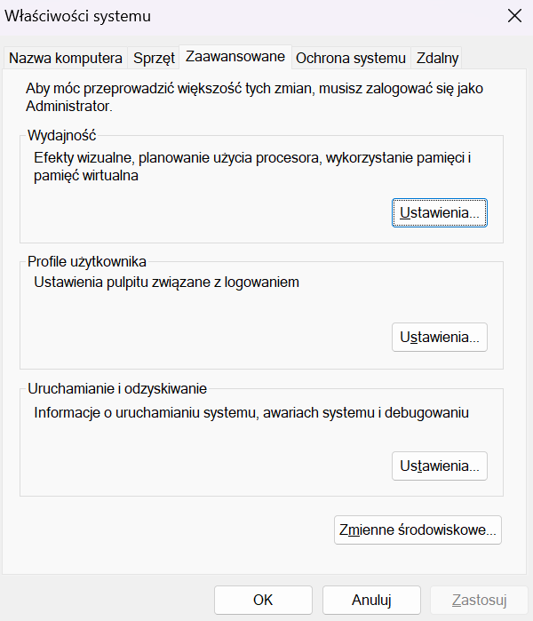
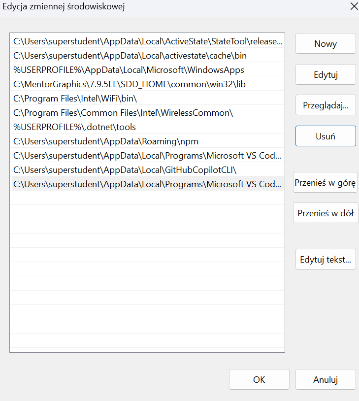
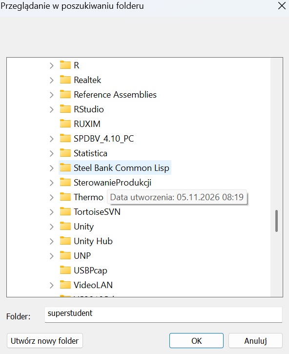

# Planowanie w PDDL: Graphplan (SGP) w VS Code

Planner **Sensory Graphplan (SGP 1.0h)** (Weld, Anderson, Smith, 1998) uruchamiany
w **SBCL** z poziomu **VS Code**, na Windows, macOS i Linuksie.
Każde uruchomienie zapisuje rozwiązanie i statystyki SGP (time-expansion, time-bc, time-mutex, graph-size, mutex-count)
do pliku JSON. Na życzenie rysuje też graf planowania.

1. [Zawartość repozytorium](#1-zawartość-repozytorium)
2. [Instalacja](#2-instalacja)
3. [Zadania (taski) i skróty klawiszowe](#3-zadania-taski-i-skróty-klawiszowe)
4. [Wyniki: rozwiązanie, statystyki i czasy](#4-wyniki-rozwiązanie-statystyki-i-czasy)
5. [Statystyki SGP](#5-statystyki-sgp)
6. [Rysunek grafu planowania](#6-rysunek-grafu-planowania)
7. [Ograniczenia: liczba kroków, czas, składnia](#7-ograniczenia-liczba-kroków-czas-składnia)
8. [Domeny](#8-domeny)

## 1. Zawartość repozytorium

```
examples/certain/gripper.pddl   informacja pewna: przykłady z rozdz. 5 PDDL.pdf (gripper-1s, gripper-1t, gripper-2)
examples/uncertain/bomb.pddl    informacja niepewna: bomba w toalecie (plan odporny i warunkowy)
examples/uncertain/sick.pddl    informacja niepewna: chory pacjent (plan warunkowy)
domains/certain/                domeny z pełną informacją o stanie początkowym (rozdz. 8)
domains/uncertain/              domeny z niepewnym stanem początkowym (rozdz. 8)
engine/                         planner SGP 1.0h (Common Lisp) i run.lisp (uruchamianie, statystyki, JSON, graf)
results/                        wyniki uruchomień: <nazwa>.json i <nazwa>.html
.vscode/                        zadania, ustawienia, rekomendowane rozszerzenie
```

## 2. Instalacja

Potrzebne są **SBCL** (Common Lisp), **VS Code** i dowolna przeglądarka
(do oglądania grafu). **Python, Node.js, Graphviz ani internet nie są
potrzebne.**

| System  | SBCL                                                                                            | VS Code                                                                               |
| ------- | ----------------------------------------------------------------------------------------------- | ------------------------------------------------------------------------------------- |
| Windows | `winget install SBCL.SBCL` lub instalator `.msi` z https://www.sbcl.org/platform-table.html | https://code.visualstudio.com                                                         |
| macOS   | `brew install sbcl` ([Homebrew](https://brew.sh))                                              | https://code.visualstudio.com lub `brew install --cask visual-studio-code`          |
| Linux   | `sudo apt install sbcl` (Debian/Ubuntu), `sudo dnf install sbcl` (Fedora)                   | https://code.visualstudio.com (`.deb`/`.rpm`) lub `snap install code --classic` |

Następnie:

1. W terminalu sprawdź `sbcl --version`. Powinno się pojawić np. `SBCL 2.x.y`.
   - Windows: jeśli polecenie nie działa, dodaj katalog SBCL do zmiennej
     `PATH` (opis niżej: [Windows: dodanie SBCL do PATH](#windows-dodanie-sbcl-do-path)).
2. W VS Code: **File → Open Folder…** i wybierz **cały folder repozytorium**.
   Bez tego zadania nie będą widoczne.
3. Zainstaluj rekomendowane rozszerzenie **PDDL** (`jan-dolejsi.pddl`), które
   VS Code zaproponuje samo. Daje kolorowanie składni, zwijanie bloków
   i konspekt domeny.
   - Rozszerzenie nie zna dialektu SGP i może podkreślać poprawne
     konstrukcje (np. kilka `define` w jednym pliku). Ignoruj te podkreślenia.
   - **Nie używaj Alt+P** („PDDL: Run the planner”), bo wysyła plik do
     zewnętrznego serwisu.
4. Test: otwórz `examples/certain/gripper.pddl`, naciśnij **Ctrl+Shift+B**
   (macOS: **Cmd+Shift+B**) i trzy razy Enter. W terminalu powinno
   pojawić się rozwiązanie problemu `gripper-1s` z 3 krokami.

### Windows: dodanie SBCL do PATH

1. Start → wpisz **zmienne środowiskowe** → **Edytuj zmienne środowiskowe
   systemu** → **Zmienne środowiskowe…**

   

2. **Zmienne użytkownika** → **Path** → **Edytuj…** → **Nowy** → **Przeglądaj…**

   

3. Wybierz `C:\Program Files\Steel Bank Common Lisp` → **OK** i zamknij
   pozostałe okna przyciskiem **OK**.

   

4. Uruchom ponownie VS Code i sprawdź `sbcl --version`.

## 3. Zadania (taski) i skróty klawiszowe

Planner uruchamia się wyłącznie zadaniami z `.vscode/tasks.json`
(**Terminal → Run Task…**). Działają one na pliku `.pddl` otwartym w edytorze.

| Zadanie                         | Co robi                                                                                                | Skrót                                                                      |
| ------------------------------- | ------------------------------------------------------------------------------------------------------ | --------------------------------------------------------------------------- |
| **SGP: planuj**           | planuje wybrany problem, wypisuje plan, zapisuje `results/<nazwa>.json`                              | **Ctrl+Shift+B** (wbudowany), **F5** (po konfiguracji poniżej) |
| **SGP: planuj + graf**    | jak wyżej, dodatkowo zapisuje `results/<nazwa>.html` z rysunkiem grafu i otwiera go w przeglądarce | **Ctrl+F5** (po konfiguracji)                                         |
| **SGP: planuj wszystkie problemy z pliku** | planuje kolejno każdy problem z pliku, zapisuje `results/<nazwa>-<problem>.json` i na końcu wypisuje tabelę zbiorczą (rozwiązanie, liczba światów, kroki, akcje, czasy) — wygodne przy serii problemów i badaniach | — |
| **SGP: lista problemów** | wypisuje nazwy problemów zdefiniowanych w pliku                                                       | **Shift+F5** (po konfiguracji)                                        |

Przy uruchomieniu VS Code zadaje pytania. Enter zatwierdza wartość domyślną.

| Pytanie                        | Znaczenie                                                                        | Domyślnie                     |
| ------------------------------ | -------------------------------------------------------------------------------- | ------------------------------ |
| **problem**              | nazwa z `(define (problem X) ...)`; `all` = wszystkie problemy z pliku         | pierwszy problem w pliku       |
| **nazwa wyniku**         | nazwa pliku w `results/` (bez rozszerzenia); istniejący plik jest nadpisywany | `<problem>-<data>-<godzina>` |
| **maks. liczba kroków** | limit kroków algorytmu, czyli maksymalna długość rozwiązania (rozdz. 7)     | 20                             |

Postęp (kolejne kroki algorytmu, linia `Levels 1 2 3 …`) widać w terminalu na bieżąco. Przerwanie:
**Ctrl+C** w terminalu zadania. Przerwane uruchomienie nie zapisuje wyniku.

**Konfiguracja skrótów F5 / Ctrl+F5 / Shift+F5.** VS Code nie pozwala
zapisać skrótów w repozytorium, więc każdy dodaje je u siebie raz:
**Ctrl+Shift+P** (macOS: **Cmd+Shift+P**) → *Preferences: Open Keyboard
Shortcuts (JSON)* i wklej do listy:

```json
{ "key": "f5",       "command": "workbench.action.tasks.runTask", "args": "SGP: planuj",          "when": "resourceLangId == pddl" },
{ "key": "ctrl+f5",  "command": "workbench.action.tasks.runTask", "args": "SGP: planuj + graf",   "when": "resourceLangId == pddl" },
{ "key": "shift+f5", "command": "workbench.action.tasks.runTask", "args": "SGP: lista problemów", "when": "resourceLangId == pddl" }
```

Skróty działają tylko w plikach PDDL, więc w innych plikach F5 nadal
uruchamia debugger. Na laptopach z macOS klawisze F wymagają zwykle
przytrzymania **fn**.

## 4. Wyniki: rozwiązanie, statystyki i czasy

Graphplan rozwija **graf planowania** złożony z dwóch typów węzłów:
**propozycji** (ang. *propositions*) i **akcji** (ang. *actions*). Poziom 0
to propozycje prawdziwe w stanie początkowym. Poziomy nieparzyste zawierają
akcje, których warunki stosowalności są obecne na poprzednim poziomie,
a parzyste zawierają propozycje otrzymane w wyniku tych akcji. **W jednym
kroku algorytmu powstaje jeden poziom akcji i jeden poziom propozycji**
(krok *k* tworzy poziomy 2*k*−1 i 2*k*).

W każdym kroku wyznaczane są **wzajemnie wykluczające się relacje** (ang.
*mutual exclusion*, **mutex**) między węzłami tego samego poziomu:

- akcje wykluczają się, jeśli jedna usuwa warunek stosowalności lub efekt
  drugiej (ang. *interference*, *inconsistent effects*);
- akcje wykluczają się, jeśli mają sprzeczne warunki stosowalności (ang.
  *competing needs*);
- propozycje wykluczają się, jeśli wszystkie metody ich osiągnięcia są
  wykluczeniami.

Po każdym kroku planner **sprawdza osiągnięcie celu metodą backtracking**.
Cel jest osiągnięty, gdy jego propozycje są na bieżącym poziomie i istnieje
niewykluczająca się metoda ich osiągnięcia. Jeśli nie, wykonywany jest kolejny krok.

### Niepewny stan początkowy: światy możliwe, plan odporny i warunkowy

Gdy stan początkowy nie jest w pełni znany (operatory `oneof`, `uncertain`,
`or` w `:init`, rozdz. 7), planner rozważa wszystkie **światy możliwe**
(ang. *possible worlds*, w SGP *contexts*), czyli wszystkie stany zgodne
z opisem. Liczby możliwości się mnożą: `oneof` z 3 faktami (3 światy)
i `uncertain` (2 światy) dają razem 3 × 2 = 6 światów. Graf planowania
jest budowany dla wszystkich światów naraz, a rozwiązanie musi osiągać cel
w każdym z nich. Planer wybierany jest automatycznie: gdy problem zawiera
niepewność albo akcje sensoryczne, działa Sensory Graphplan (SGP),
w przeciwnym razie Graphplan (GP).

| Rozwiązanie | Kiedy | Jak wygląda |
| --- | --- | --- |
| **plan klasyczny** (GP) | stan początkowy znany | ciąg kroków |
| **plan odporny** (ang. *conformant*) | brak informacji o tym, w którym świecie jesteśmy | jeden ciąg kroków, poprawny w każdym świecie |
| **plan warunkowy** (ang. *contingent*) | akcje sensoryczne (`observes`) pozwalają rozpoznać świat | część akcji jest wykonywana tylko w niektórych światach |

W planie warunkowym zapis `dunk (pkg1, toilet1)   ; pomiń w światach 1 2 3 4`
oznacza, że akcję wykonuje się wyłącznie w świecie 5. Wcześniejsze akcje
sensoryczne pozwalają rozpoznać, w którym świecie jest agent. Dla planu
warunkowego terminal wypisuje dodatkowo **rozwiązanie dla każdego świata**
osobno, a na początku listę światów możliwych z faktami, którymi się różnią:

```
Światy możliwe (5) -- fakty, którymi się różnią:
   1: in (pkg5), metal (pkg5)
   …
ROZWIĄZANIE (SGP, plan warunkowy), liczba kroków planu: 2
  1°
     detect-metal (pkg2)
     …
  2°
     dunk (pkg1, toilet1)   ; pomiń w światach 1 2 3 4
     …
Rozwiązanie dla każdego świata:
   1: 1° detect-metal (pkg2), …  |  2° dunk (pkg5, toilet1)
```

Jeśli plan odporny jest nie dłuższy niż warunkowy, SGP wybiera plan odporny,
nawet gdy akcje sensoryczne są dostępne. Plan warunkowy powstaje dopiero
wtedy, gdy działanie „na ślepo” nie prowadzi do celu, np. gdy toaleta zatyka
się po każdym zanurzeniu paczki (`bt-1sa`) albo gdy lek na złą chorobę szkodzi
(`sick`).

## 5. Statystyki SGP

Po rozwiązaniu w terminalu pojawia się tabela, a te same dane trafiają do `results/<nazwa>.json`:

| Dana statystyczna        | Opis                                                                              | Pole w JSON (każdy krok)                             |
| ------------------------ | --------------------------------------------------------------------------------- | ----------------------------------------------------- |
| **time-expansion** | czas potrzebny na rozwinięcie grafu w danym kroku algorytmu (zawiera time-mutex) | `time_expansion_ms`                                 |
| **time-bc**        | czas sprawdzania osiągnięcia celu (backtracking) po rozwinięciu grafu          | `time_bc_ms`                                        |
| **time-mutex**     | czas wyznaczania wzajemnie wykluczających się relacji                           | `time_mutex_ms`                                     |
| **graph-size**     | liczba akcji (łącznie z no-op) i propozycji otrzymanych w danym kroku           | `graph_size.actions`, `graph_size.propositions`   |
| **mutex-count**    | liczba wzajemnie wykluczających się relacji akcji i propozycji                  | `mutex_count.actions`, `mutex_count.propositions` |

Przykład dla `gripper-1t` z `examples/certain/gripper.pddl`:

```
Krok  time-expansion    time-bc  time-mutex  graph-size          mutex-count
                [ms]       [ms]        [ms]  (akcje,propozycje)  (akcje,propozycje)
   1           0.024      0.001       0.008  (13,15)             (18,36)
   2           0.044      0.001       0.014  (21,15)             (138,24)
   3           0.033      0.006       0.016  (22,16)             (142,32)
   Σ           0.101      0.008       0.038
   Σ  time-expansion + time-bc = 0.109 ms
```

Uwagi:

- **Czasy** podawane są w milisekundach. Łączny czas wyznaczania planu to
  Σ time-expansion + Σ time-bc, bo time-mutex jest częścią time-expansion.
  Pole `time_ms.total` zawiera dodatkowo narzut na przygotowanie problemu.
- **mutex-count** liczy każdą parę wykluczających się węzłów dwukrotnie
  (A–B i B–A), tak jak SGP. Liczba par to połowa tej wartości.
- **graph-size** zależy od zapisu domeny. Wersja STRIPS ma więcej propozycji
  niż wersja TYPING, bo typy obiektów są w niej propozycjami, np. `ball (ball1)`.
- Przy niepewności **graph-size** liczy propozycje bez podziału na światy
  (tak jak SGP), a akcje osobno w każdym świecie, więc rośnie razem z liczbą światów.

Pozostałe pola `results/<nazwa>.json`:

| Pole                              | Znaczenie                                                                                                               |
| --------------------------------- | ----------------------------------------------------------------------------------------------------------------------- |
| `name`, `created`             | nazwa wyniku, data i godzina uruchomienia                                                                               |
| `file`, `problem`, `domain` | plik, problem i domena                                                                                                  |
| `planner`                       | `gp` (Graphplan) lub `sgp` (Graphplan z niepewnością, wybierany automatycznie, gdy domena jej używa)             |
| `max_steps`                     | limit kroków algorytmu                                                                                                 |
| `solved`, `stop_reason`       | czy znaleziono rozwiązanie i dlaczego planner się zatrzymał (rozdz. 7)                                               |
| `plan_type`                     | rodzaj rozwiązania: `classical` (plan klasyczny), `conformant` (plan odporny), `conditional` (plan warunkowy)         |
| `worlds`, `worlds_init`         | liczba światów możliwych i fakty, którymi się różnią (tylko przy niepewności)                                        |
| `warnings`                      | ostrzeżenia plannera                                                                                                   |
| `plan_steps`, `plan_actions`  | liczba kroków rozwiązania i liczba akcji w rozwiązaniu                                                               |
| `algorithm_steps`               | liczba wykonanych kroków algorytmu                                                                                     |
| `initial_propositions`          | liczba propozycji na poziomie 0 (stan początkowy)                                                                      |
| `time_ms`                       | sumy: `expansion`, `bc`, `mutex` oraz `total`                                                                   |
| `steps[]`                       | statystyki każdego kroku (tabela wyżej) oraz `noops`, czyli liczba akcji no-op wliczonych do `graph_size.actions` |
| `plan[]`                        | rozwiązanie: kolejne kroki (`step`) z listą akcji; w planie warunkowym `skip_in_worlds` = światy, w których akcję się pomija |
| `plan_per_world[]`              | (plan warunkowy) rozwiązanie dla każdego świata osobno                                                                 |
| `planner_output`                | tekst wypisany przez planner                                                                                            |

Rozwiązanie jest **równoległe**: akcje w jednym kroku (np. `1°`) nie wykluczają
się i można je wykonać jednocześnie. Graphplan minimalizuje liczbę kroków,
a nie liczbę akcji.

## 6. Rysunek grafu planowania

Zadanie **SGP: planuj + graf** tworzy `results/<nazwa>.html`. To samodzielny
plik bez zewnętrznych bibliotek, który działa offline w każdej przeglądarce.

- Kolumny odpowiadają poziomom grafu: **poziom 0**: propozycje (stan
  początkowy), **poziom 1**: akcje (krok 1), **poziom 2**: propozycje, …
- Propozycje mają zaokrąglone ramki, a akcje prostokątne. Akcje rozwiązania
  są **zielone i pogrubione**.
- Zapis jak w `PDDL.pdf`: `at (ball1, rooma)`, a negacja to `¬ free (arm)`.
- Krawędzie łączą propozycję z akcją (**warunek stosowalności**) i akcję
  z propozycją (**efekt**). **Wzajemne wykluczania (mutex)** to czerwone
  przerywane łuki.
- **Akcje typu no-operation (no-op)** Graphplan dodaje dla każdej propozycji.
  Przenoszą one propozycję bez zmian na następny poziom („nic nie rób,
  propozycja pozostaje prawdziwa”). Mają etykietę `no-op: …` i przerywaną
  ramkę. Domyślnie są ukryte (przełącznik *pokaż akcje no-op*).
- Najechanie na węzeł podświetla jego warunki stosowalności, efekty
  i wykluczenia, a resztę przyciemnia.
- Przełącznik *tylko rozwiązanie* pokazuje same akcje rozwiązania i ich
  propozycje. Przydaje się przy dużych grafach, np. `gripper-2`.
- Przy niepewności każdy węzeł ma numer świata, np. `in (pkg1) {3}`, a akcje
  rozwiązania są zielone tylko w światach, w których są wykonywane. Lista
  *świat* pozwala pokazać graf jednego świata, co znacznie go zmniejsza.
- Panel boczny zawiera rozwiązanie, `graph-size` i `mutex-count` dla
  każdego kroku oraz czasy.

## 7. Ograniczenia: liczba kroków, czas, składnia

**Liczba kroków.** Rozwiązanie z *n* krokami planner może znaleźć dopiero
w *n*-tym kroku algorytmu. Maksymalną długość rozwiązania wyznacza więc pytanie
**maks. liczba kroków** (domyślnie 20). W wersji SGP używanej dawniej
w Allegro CL limit wynosił 10, dlatego `PDDL.pdf` podaje, że
„plan generowany przez SGP składa się maksymalnie z 10 kroków”. Gdy
rozwiązania nie ma, terminal i pole `stop_reason` mówią dlaczego:

- `BRAK PLANU: graf się wyrównał po N krokach algorytmu, plan nie istnieje.`
  (`leveled_off`): kolejne kroki nic by nie zmieniły i zwiększanie limitu nie pomoże;
- `BRAK PLANU: osiągnięto limit N kroków algorytmu.` (`level_limit`):
  uruchom ponownie z większą wartością;
- `BRAK PLANU: domena używa konstrukcji nieobsługiwanych przez SGP`
  (`unsupported`): patrz *Składnia* niżej.

Przy niepewności (SGP) planner nie wykrywa wyrównania grafu: gdy rozwiązanie
nie istnieje, zawsze liczy do limitu kroków (`level_limit`). Tak jest np.
w `bt-dd3`, gdzie w jednym ze światów bomby w ogóle nie ma.

**Czas.** Planner nie ma limitu czasu i liczy do skutku albo do przerwania
klawiszami **Ctrl+C**. Czas rośnie bardzo szybko z liczbą obiektów i długością
rozwiązania. Najbardziej rośnie **time-bc**, bo przeszukiwanie metodą
backtracking ma coraz więcej możliwości. Pomiary (SBCL 2.6.10, procesor
Apple M), w porównaniu z `PDDL.pdf` (Allegro CL, Intel Core 2 Duo, 2011):

| Problem                                            | Kroki | Czas (SBCL) | Czas w `PDDL.pdf` |
| -------------------------------------------------- | ----: | ----------: | ------------------: |
| `examples/certain/gripper.pddl` / `gripper-1t`          |     3 |     ~0,1 ms |             0,408 s |
| `examples/certain/gripper.pddl` / `gripper-2`           |     9 |      ~10 ms |            21,869 s |
| `domains/certain/gripper.pddl` / `gripper6` (6 piłek) |    11 |        ~2 s |                  — |
| `domains/certain/gripper.pddl` / `gripper8` (8 piłek) |    — |      > 30 s |                  — |

Przy niepewności czas rośnie także z **liczbą światów możliwych**. Seria
`sick-3-1ill` … `sick-3-5ill` z `examples/uncertain/sick.pddl` (1…5 światów,
ten sam plan z 3 kroków):

| Światy | 1 | 2 | 3 | 4 | 5 |
| --- | ---: | ---: | ---: | ---: | ---: |
| Czas (SBCL) | ~0,04 ms | ~0,4 ms | ~2 ms | ~17 ms | ~170 ms |

Do każdego uruchomienia dochodzi ok. 0,6 s na załadowanie plannera.

**Składnia.** SGP rozumie PDDL 1.x:

- w jednym pliku może być wiele domen i problemów, a wielkość liter nie ma znaczenia;
- obsługiwane są `:strips`, `:typing`, `:equality`, efekty warunkowe (`when`),
  alternatywy w warunkach stosowalności oraz `forall`/`exists`;
- **nieobsługiwane** są `:domain-axioms` (aksjomaty), `:safety-constraints`,
  liczby i funkcje, akcje ciągłe (*durational actions*) oraz negacje formuł
  złożonych (np. `(not (exists ...))`). Planner wypisuje wtedy
  `UWAGA: Planner is unlikely to work…`;
- nierówność `(not (= ?x ?y))` umieszczaj na końcu warunku stosowalności;
- parametr akcji, który nie występuje w warunku stosowalności, jest wiązany
  tylko wtedy, gdy domena deklaruje `:typing` (albo `:adl`).

**Niepewność stanu początkowego** (`:init`) i akcje sensoryczne:

| Konstrukcja | Znaczenie | Liczba światów |
| --- | --- | --- |
| `(oneof A B C)` | prawdziwy jest dokładnie jeden z faktów | 3 |
| `(uncertain A)` | A może być prawdziwy albo fałszywy | 2 |
| `(or A B)` | prawdziwy jest co najmniej jeden z faktów | 3 (A; B; A i B) |
| `(iff A B)` | A jest prawdziwy wtedy i tylko wtedy, gdy B | nie dodaje światów, wiąże fakty |
| `(observes P)` | efekt akcji sensorycznej: po jej wykonaniu wiadomo, czy P jest prawdziwe | — |

Operatory można łączyć w jednym `:init`; liczba światów to wtedy iloczyn.
W dziedzinach z niepewnością fakty fałszywe zapisuje się w `:init` jawnie,
np. `(not (clogged))`, tak jak w przykładach z `examples/uncertain/`.

## 8. Domeny

Pliki pochodzą z dystrybucji SGP 1.0h. Każdy problem sprawdzono z limitem
30 kroków algorytmu i 30 s:

- **Rozwiązane**: plan znaleziony.
- **Bez planu**: graf się wyrównał (planu nie ma), osiągnięto limit kroków
  albo problem używa nieobsługiwanej konstrukcji. W MYSTERY część problemów
  celowo nie ma rozwiązania.
- **> 30 s**: obliczenia trwały dłużej niż 30 s.

### `domains/certain/` – pełna informacja o stanie początkowym

### `domains/uncertain/` – niepewny stan początkowy

SGP: Copyright (c) Mark Peot, 1995; University of Washington, 1997–2000 (`engine/SGP-README.txt`).
